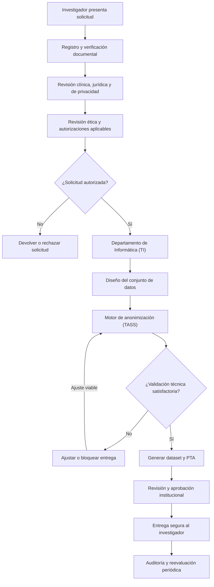

# TASS — Visión de la Solución, Giro Estratégico y Alineación con el Código

> **Nombre de la solución:** **TASS** (*Privacy Gateway del IESS para la entrega auditable y anonimizada de datos clínicos orientados a la finalidad del estudio*).

---

## 1. ¿Qué giro le estamos dando con TASS?

La mayoría de equipos en el **Reto 2 («Tus datos, tus derechos»)** van a entregar un *script* o pantalla aislada que sube un CSV, borra columnas y escupe otro CSV anonimizado.

El giro que plantea **TASS** —reflejado en sus diagramas conceptuales— es pasar de una *«herramienta suelta de anonimización»* a una **Puerta de Privacidad Institucional (*Privacy Gateway IESS*) de extremo a extremo**:

1. **Orientada a la finalidad del estudio:** No anonimiza «a ciegas». Todo arranca con una **solicitud aprobada** que define estrictamente qué cohorte (periodo + CIE-10) y qué variables mínimas están autorizadas.
2. **Pre-procesamiento inteligente con Bot/IA:** Antes de anonimizar, un componente de IA inspecciona la base de datos de origen (venga del hospital o formato que venga), evalúa consistencia y estandariza columnas/formatos con supervisión humana.
3. **Motor de decisión variable por variable:** Cada columna del diccionario pasa por un árbol explícito: *¿Uso autorizado?* → *¿Solo procesamiento interno?* → *Tipo de variable (identificador directo, numérica, geográfica, temporal, categórica, atributo objetivo, texto libre)* → *Registro auditable de la decisión*.
4. **Control de liberación con bucle riesgo–utilidad:** Ningún dataset puede liberarse sin pasar el umbral de control ($k \ge 5$, $0$ identificadores directos ni en texto libre, y evaluación de utilidad y grupos homogéneos). Si falla, el flujo bloquea la entrega y obliga a reajustar la generalización.
5. **Entrega vinculante y trazabilidad total (LOPDP / SPDP):** Antes de habilitar la descarga final, el investigador debe **firmar un acuerdo de confidencialidad y cumplimiento LOPDP/SPDP**, quedando evidencia técnica (PTA + configuración + trazabilidad + bitácora de auditoría) y un ciclo de **reevaluación periódica del riesgo residual**.

---

## 2. Arquitectura Conceptual de TASS (según las imágenes del equipo)

Las imágenes proporcionadas estructuran TASS en **5 capas complementarias**:

### Capa A · Gobernanza Institucional de Extremo a Extremo

### Capa B · Bot de Revisión y Estandarización (Pre-etapa IA)
- **Entrada:** Prerrequisito `Solicitud aprobada` + `Base de datos`.
- **Proceso:** `Bot revisa los datos` → `¿Datos consistentes?`
  - Si **No**: `Estandarizar los datos` (nombres de columnas, formatos de fecha, sexo, tipos de atención).
  - Si **Sí** (o tras estandarizar): pasa a `Ingreso de datos para categorizar` (`fecha de cohorte` + `código de diagnóstico`).

### Capa C · Árbol de Decisión por Variable del Diccionario
Para cada variable de la base:
1. **¿Uso autorizado?** → No: *Suprimir columna*.
2. **¿Solo necesaria para procesamiento interno?** (ej. `cédula` para unir atenciones o `edad`/`fecha_ingreso` para filtrar cohorte) → Sí: *Procesar internamente y excluir del resultado*.
3. **Si sale al dataset**, se clasifica por tipo:
   - *Identificador directo* → Suprimir o generar código aleatorio sin correspondencia.
   - *Numérica* → Generalizar rangos y agrupar extremos.
   - *Geográfica* → Generalizar mediante jerarquías (provincia → región).
   - *Temporal* → Generalizar fecha (`AAAA-MM` o año).
   - *Categórica* → Conservar o recodificar.
   - *Atributo objetivo* → Conservar o transformar según riesgo (ej. CIE-10).
   - *Texto libre* → Suprimir o enmascarar y revisar fugas.
4. **Registrar decisión** (trazabilidad por columna) hasta evaluar el dataset completo.

### Capa D · Pipeline de Clasificación, Anonimización, Medición y Entrega
1. Eliminación de datos no relevantes → Ingreso de `fecha de cohorte` y `código de diagnóstico`.
2. **Clasificación / Anonimización:**
   - Segmentar rangos de edades.
   - Clasificación de tipo de paciente *(Neonatal, Pediátrico, Adulto, Geriátrico, Obstétrico)*.
   - Generalización de ubicación *(Provincia o Región)*.
   - Agrupación temporal *(Tiempo de estancia bajo cuidados médicos)*.
   - $k$-Anonimato sobre `edad – ubicación – sexo`.
3. **Medición:** Generar `Dataset de salida` → `Medir riesgo: k >= 5`.
   - Si **No cumple**: `Cambiar segmentación de ubicación` y reevaluar $k$-anonimato.
   - Si **Sí cumple**: `Generación de PDF/Excel con los datos` → `Firma de acuerdo de confidencialidad, LOPDP, SDPD` → `¿Usuario firmó?` (No: mantiene bloqueado; Sí: `Archivo descargable`).

### Capa E · Los 12 Procesos Técnicos del Privacy Gateway IESS
1. Recepción de solicitud aprobada → *Solicitud estructurada*
2. Validación contra el catálogo de datos → *Variables y filtros permitidos*
3. Extracción de la cohorte → *Dataset temporal*
4. Medición inicial y minimización → *Riesgo inicial y datos necesarios*
5. Clasificación de variables → *Política por atributo*
6. Aplicación de técnicas → *Dataset candidato*
7. Evaluación de riesgo y utilidad → *Métricas cuantificables*
8. Optimización iterativa → *Configuración seleccionada*
9. Control de liberación ($k \ge 5$, $0$ identificadores, utilidad suficiente) → *Aprobación o bloqueo*
10. Generación del PTA → *Evidencia y trazabilidad*
11. Entrega y eliminación de temporales → *CSV protegido*
12. Reevaluación periódica → *Control de riesgo residual*

---

## 3. ¿Coincide el flujo de las imágenes con lo que tenemos en el código?

Aquí está el **mapa exacto de coincidencia** entre el diseño conceptual de TASS (las imágenes) y el código que corre hoy en la rama `framework`:

| Componente en las imágenes de TASS | Estado en el código actual | Detalle real |
|---|---|---|
| **Solicitud aprobada previa + envío a TI** | ✅ **Coincide** | El Comité de Ética sube el PDF aprobado, define destinatario y filtro CIE-10/periodo y envía a TI. TI puede devolver con motivo o tomarla. |
| **Bot IA revisa consistencia y estandariza** | ✅ **Coincide** | `src/ia/estandarizar.js` detecta separador/codificación, clasifica las 28 columnas con modelo softmax, pregunta formatos ambiguos y exige confirmación humana. |
| **Ingreso de fecha de cohorte + código de diagnóstico** | ✅ **Coincide** | El filtro CIE-10 (capítulo, grupo, categoría) y rango de años viene fijado desde la petición y extrae la cohorte exacta. |
| **Árbol de decisión variable por variable + trazabilidad** | ✅ **Coincide** | `src/motor/motor.js` clasifica las 28 variables, suprime no autorizadas/texto libre, generaliza cuasiidentificadores y registra la trazabilidad columna por columna. |
| **Segmentar edades, ubicación (provincia/región), fechas, estancias y $k$-anonimato** | ✅ **Coincide** | Soportado en configuración *Referencia* (fija del jurado) y *Propia* (editable: $k$, ancho de edad, provincia/región, mes/año, $l$-diversidad y tope de estancia). |
| **Control de liberación ($k \ge 5$, $0$ identificadores, 8 verificaciones)** | ✅ **Coincide** | Si falla cualquiera de las verificaciones V-01 a V-08, el veredicto es **NO APTO** y el botón de publicar queda bloqueado. |
| **Generación de PTA + trazabilidad + eliminación de temporales** | ✅ **Coincide** | Genera `PTA.html`, `trazabilidad.json`, `configuracion.json`, `salida.csv` y paquete `.zip`. Los datos de pacientes viven solo en memoria volátil. |
| **Firma de acuerdo de confidencialidad (LOPDP) antes de descargar** | ✅ **Coincide** | El doctor/autorizado ingresa con su licencia y teclado virtual; las descargas están bloqueadas con candado hasta marcar y firmar el acuerdo. |
| **Clasificación de tipo de paciente (Neonatal, Pediátrico, Adulto, Geriátrico, Obstétrico)** | ❌ **NO está en código** | El código filtra estrictamente `edad >= 18` (como pide la solicitud del Reto 2) y agrupa en rangos de edad numéricos (`18-39`, `40-59`, `60-79`, `80+`). |
| **Bucle automático «Cambiar segmentación de ubicación» si $k < 5$** | ⚠️ **Parcial** | El motor no cambia automáticamente de Provincia a Región cuando $k < 5$; aplica supresión local de personas con $k < 5$ y permite al operador cambiar manualmente de Provincia a Región y re-medir. |
| **Generación de PDF / Excel con los datos** | ⚠️ **Parcial** | Genera **CSV** (estándar exigido por `05_Diccionario_de_datos.xlsx`), **JSON** y **PTA en HTML** (imprimible a PDF), empaquetados en **ZIP**. No exporta `.xlsx` ni `.pdf` nativo. |
| **Revisión y aprobación institucional post-PTA (antes de entrega)** | ❌ **NO está en código** | Actualmente TI publica directamente al investigador sin una segunda aprobación de un supervisor o comité sobre el PTA generado. |
| **Reevaluación periódica (control anual de riesgo residual)** | ❌ **NO está en código** | No existe módulo ni calendario de reevaluación anual del riesgo residual (solo aparece mencionado en el texto del PTA). |

---

## 4. Cómo presentar TASS al jurado sin contradicciones

Para que la narrativa en el Demo Day (y Gran Final) sea **100 % coherente y ganadora**:

1. **MVP Demostrable hoy (en vivo):** TASS ejecuta el ciclo real completo del Reto 2: **Solicitud aprobada → Bot IA de estandarización con confirmación humana → Motor de anonimización ($k$-anonimato + $l$-diversidad + 8 verificaciones V-01..V-08) → Generación de PTA y trazabilidad → Firma de acuerdo LOPDP y descarga controlada + Logs de auditoría**.
2. **Hoja de ruta / Continuidad institucional (criterios *Viabilidad 10 %* y *Sostenibilidad 10 %*):** Posicionar explícitamente como **Fase 2 de escalamiento con el IESS** los bloques que aparecen en los diagramas macro y aún no están en el prototipo de 2 días:
   - Perfiles clínicos ampliados (*Neonatal, Pediátrico, Geriátrico, Obstétrico*) para futuros estudios fuera de salud mental adulta.
   - Doble aprobación institucional post-PTA y alertas automáticas de **reevaluación anual de riesgo residual (SPDP 2026)**.
   - Integración con IAM institucional del IESS, firma electrónica oficial y bitácora inmutable en servidor (*append-only / WORM*).
